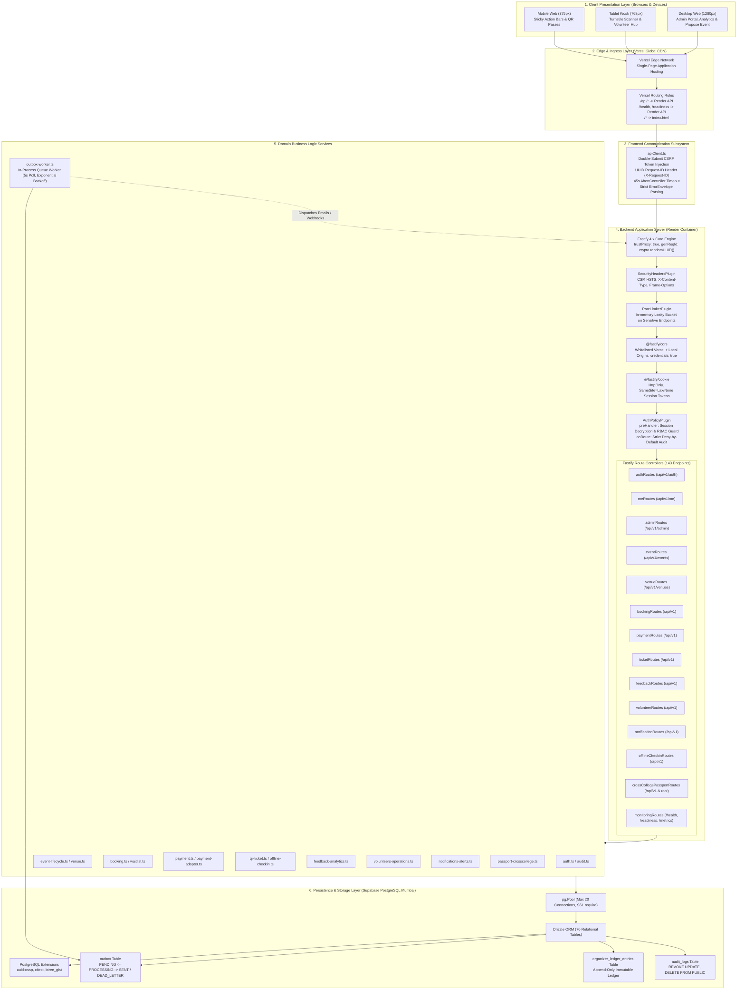
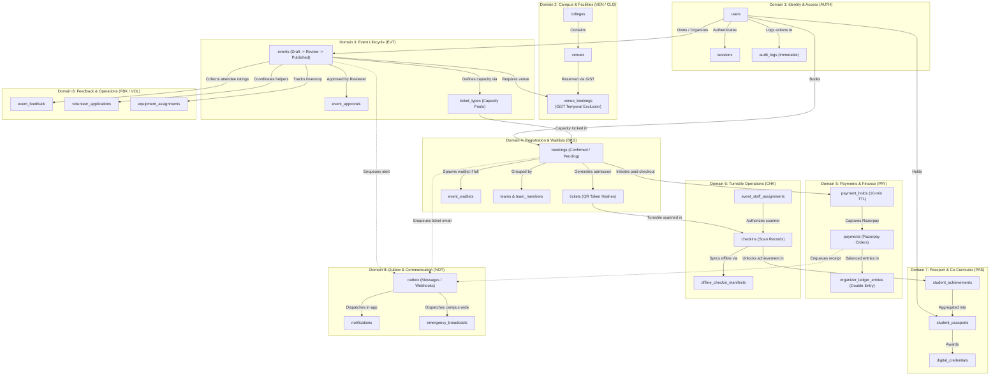
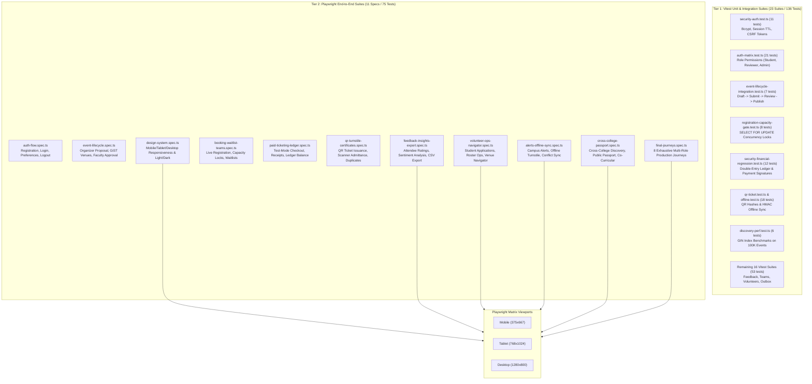

# EVENTORA SYSTEM ARCHITECTURE & DEPENDENCY MAP
**Phase**: `PHASE 1 — FEATURE GRAPH`  
**Generated Date**: October 25, 2026  
**Methodology**: Direct source code inspection across `@eventora/shared`, `@eventora/backend`, and `@eventora/frontend`, Fastify 4.x plugin hierarchy, Drizzle ORM schema (70 tables), React route tree, and background workers.

---

## 1. Executive Architectural Overview

Eventora is structured as a pnpm workspace monorepo consisting of three tightly integrated packages:
- **`@eventora/shared`**: Universal data contracts, Zod schemas, error envelope specifications (`createErrorEnvelope`), permission matrices, and TypeScript type declarations shared across backend and frontend.
- **`@eventora/backend`**: High-throughput Fastify 4.x HTTP API server, Drizzle ORM PostgreSQL persistence engine, in-process transactional outbox background worker, security header guards, and role-based access control (RBAC) middleware.
- **`@eventora/frontend`**: React 18 single-page application bundled with Vite, TailwindCSS design system, Lucide icons, QR code generation/scanning canvas, and HTML5 offline caching.

### Key Operational Invariants
1. **Zero External Runtime Daemon Dependencies**: The production backend is designed to run reliably within Render's free container runtime without requiring separate Redis, Celery, or RabbitMQ clusters. State is mediated entirely via Supabase PostgreSQL using atomic transactions, `SELECT FOR UPDATE` row locks, and an in-process transactional outbox queue.
2. **Deterministic Double-Booking Prevention**: Venue schedules are strictly guarded using PostgreSQL `btree_gist` exclusion constraints (`tsrange`), preventing double-bookings at the storage engine level.
3. **Double-Entry Financial Auditing**: All ticket holds, purchases, platform fees, refunds, and organizer disbursements write append-only balanced debit/credit records to `organizer_ledger_entries`.
4. **Offline Turnstile Resiliency**: Checkin stations download cryptographically signed offline manifests (HMAC-SHA256) into browser memory/IndexedDB, allowing rapid QR admittance during network blackouts with deterministic reconciliation upon reconnection.

---

## 2. Multi-Tier Architecture & Layer Topology



---

## 3. End-to-End Request Pipeline & Middleware Chain

Every HTTP request originating from the browser passes through a deterministic security, authentication, and execution pipeline:

```
[Browser Request]
       │
       ▼
 1. Vercel Edge CDN:
    - Route inspection: Static asset vs API rewrite
    - Rewrites /api/* to Render backend (e.g., https://eventora-api-p35a.onrender.com/api/v1/...)
       │
       ▼
 2. Fastify Network Ingress:
    - trustProxy evaluates X-Forwarded-For to determine client IP
    - genReqId generates standard UUID for tracing: req.id
       │
       ▼
 3. Security Headers Plugin (securityHeadersPlugin):
    - Injects Strict-Transport-Security: max-age=31536000; includeSubDomains
    - Injects X-Content-Type-Options: nosniff
    - Injects X-Frame-Options: DENY
    - Injects Content-Security-Policy with strict script/style src rules
       │
       ▼
 4. Rate Limiter Plugin (rateLimiterPlugin):
    - Identifies client by IP + User-Agent
    - Protects /api/v1/auth/* (5 requests / min on login/register)
    - Returns 429 Too Many Requests in ErrorEnvelope format on threshold exceed
       │
       ▼
 5. Content-Type Parser:
    - Buffers raw request body to req.rawBody for timing-safe HMAC-SHA256 signature verification (used in Razorpay webhooks)
    - Safely parses JSON payloads into req.body; returns 400 Bad Request on syntax failure
       │
       ▼
 6. Fastify CORS (@fastify/cors):
    - Inspects Origin header against whitelist (eventora-jet.vercel.app, *.vercel.app, localhost)
    - Sets Access-Control-Allow-Credentials: true
    - Allows X-CSRF-Token, X-Request-ID, Idempotency-Key
       │
       ▼
 7. Cookie Parser (@fastify/cookie):
    - Extracts session cookie eventora_session and CSRF cookie eventora_csrf
       │
       ▼
 8. Authentication & Policy Plugin (authPolicyPlugin):
    - Reads session token from cookie (or Bearer Authorization header)
    - Validates session existence in sessions table (TTL check & user status check)
    - Decorates request: req.user, req.authSession, req.permissions
    - Checks route security definition:
        * public: Permits unauthenticated access
        * authenticated: Requires active session
        * requireRole(roles...): Enforces global role (student, reviewer, admin)
        * requirePermission(perm): Enforces fine-grained permission string
    - Double-Submit CSRF Verification on non-GET / non-HEAD requests
       │
       ▼
 9. Route Controller Execution:
    - Input validation via Zod schemas
    - Invokes domain service method within PostgreSQL transaction (if mutating state)
    - Sets standard response headers (X-Request-ID, Content-Type: application/json)
       │
       ▼
10. Global Error / 404 Handler:
    - Formats all exceptions into canonical ErrorEnvelope:
      { error: { code, message, details, requestId } }
    - Sanitizes internal Postgres error codes and stack traces in production
       │
       ▼
11. onResponse Hook:
    - Calculates durationSec = reply.elapsedTime / 1000
    - Records metrics: recordMetricRequest(method, route, statusCode, duration)
```

---

## 4. Cross-Domain Dependency Graph

Eventora's 12 functional domains are decoupled through clear database boundaries and asynchronous outbox events:



---

## 5. Database Schema & Data Integrity Topology

The persistence layer comprises 70 Drizzle ORM relational tables backed by PostgreSQL on Supabase (AWS Mumbai, Port 5432).

### 5.1 Concurrency Controls & Atomic Locking
1. **Ticket Capacity Race Conditions**:
   - `createBooking` executes inside a serializable/read-committed transaction.
   - Executes `SELECT quantity_total, quantity_sold FROM ticket_types WHERE id = $1 FOR UPDATE`.
   - Re-checks available spots: `if (quantity_sold + requestedQuantity > quantity_total) throw CapacityExceededError`.
   - Atomically updates `quantity_sold = quantity_sold + requestedQuantity`.
2. **Venue Double-Booking Prevention**:
   - `venue_bookings` uses PostgreSQL `btree_gist` extension:
     ```sql
     EXCLUDE USING gist (
       venue_id WITH =,
       booking_interval WITH &&
     ) WHERE (status IN ('confirmed', 'tentative'))
     ```
   - Any simultaneous attempt by two organizers to book overlapping intervals in the same venue is rejected at the database engine level with SQLSTATE `23P01` (`exclusion_violation`).
3. **Double-Entry Financial Ledger**:
   - `organizer_ledger_entries` enforces append-only accounting.
   - Every transaction records both `debit_cents` and `credit_cents` alongside `organizer_id`, `event_id`, and `payment_id`.
   - Prevents retroactive manipulation or deletion of ticketing revenue.
4. **Append-Only Security Audit Trail**:
   - Table `audit_logs` has explicit database privilege restrictions:
     ```sql
     REVOKE UPDATE, DELETE, TRUNCATE ON audit_logs FROM PUBLIC;
     ```
   - Guarantees that neither application vulnerabilities nor privileged users can alter the historical log of administrative actions or logins.

---

## 6. Background Workers & Transactional Outbox Subsystem

To eliminate external message broker dependencies (e.g. Redis/RabbitMQ) while maintaining zero message loss, Eventora employs the **Transactional Outbox Pattern**:

```
[Domain Service Mutation]
          │
          ▼
   BEGIN TRANSACTION
     ├── 1. INSERT / UPDATE business table (e.g., bookings, payments)
     └── 2. INSERT INTO outbox (topic, payload, status = 'PENDING', scheduled_for = NOW())
   COMMIT
          │
          ▼
[In-Process Outbox Worker (outbox-worker.ts)]
   ├── Polls every 5,000ms:
   │   SELECT * FROM outbox 
   │   WHERE status = 'PENDING' AND scheduled_for <= NOW() 
   │   ORDER BY created_at ASC 
   │   LIMIT 20 
   │   FOR UPDATE SKIP LOCKED;
   │
   ├── Marks records as 'PROCESSING'
   ├── Dispatches handlers based on topic:
   │   ├── 'ticket.issued': Generates QR ticket pass email notification
   │   ├── 'payment.receipt': Sends digital payment breakdown
   │   ├── 'event.cancelled': Broadcasts cancellation & refund notice
   │   ├── 'emergency.broadcast': Dispatches urgent student push alert
   │   └── 'webhook.forward': Forwards signed payload to external endpoint
   │
   ├── On Success:
   │   UPDATE outbox SET status = 'SENT', processed_at = NOW();
   │
   └── On Failure:
       ├── If retry_count < max_retries (default: 5):
       │   UPDATE outbox 
       │   SET retry_count = retry_count + 1, 
       │       scheduled_for = NOW() + (POW(2, retry_count) * 10 seconds),
       │       status = 'PENDING',
       │       last_error = $err;
       └── If retry_count >= max_retries:
           UPDATE outbox SET status = 'DEAD_LETTER', last_error = $err;
```

---

## 7. External Integrations & Infrastructure Topology

```mermaid
flowchart LR
    subgraph Clients ["Client Platforms"]
        WebUser["Student / Organizer / Admin<br/>Browser"]
    end

    subgraph VercelInfra ["Vercel Edge Platform (US East CDN)"]
        VercelSPA["Eventora SPA (React + Vite)<br/>https://eventora-jet.vercel.app"]
        VercelEdge["Edge Proxy Rules<br/>/api/* -> Render API"]
    end

    subgraph RenderInfra ["Render Cloud Platform (Free Web Service)"]
        RenderService["Eventora Fastify Server<br/>https://eventora-api-p35a.onrender.com<br/>Port 10000 (Internal) / 443 (Edge)"]
        RenderCron["In-Process Outbox Worker<br/>5s Polling Engine"]
    end

    subgraph SupabaseInfra ["Supabase PostgreSQL (AWS Mumbai ap-south-1)"]
        SupaPool["Supabase Transaction Pooler<br/>Port 5432 (PgBouncer / Direct)"]
        SupaDB["PostgreSQL Database (eventora-prod)<br/>Schema Migration Version 11"]
    end

    subgraph ExternalThirdParties ["External Services & Gateways"]
        Razorpay["Razorpay Payment Gateway<br/>Order Creation & HMAC Webhooks"]
        EmailService["Transactional Email Service<br/>(SMTP / SES / Outbox Logger)"]
    end

    WebUser -->|HTTPS GET /| VercelSPA
    WebUser -->|HTTPS API Requests| VercelEdge
    VercelEdge -->|Proxied HTTPS| RenderService
    RenderService -->|Database Pool (SSL)| SupaPool
    SupaPool --> SupaDB
    RenderCron -->|Transactional Outbox| SupaDB
    RenderService -->|Order Creation API| Razorpay
    Razorpay -.->|POST /api/v1/webhooks/payments| RenderService
    RenderCron -.->|Dispatches Outbox Emails| EmailService
```

---

## 8. Offline Resilience & Check-in Turnstile Sync Architecture

At large campus events with poor cellular connectivity, check-in staff can operate fully offline:

```
                  ONLINE PRE-EVENT
                         │
                         ▼
1. Staff Device requests: GET /api/v1/events/:id/turnstile/offline-manifest
2. Backend generates signed HMAC-SHA256 manifest containing:
   - Event metadata & sessions
   - Valid ticket hashes: { ticketId, qrHash, attendeeName, seatNumber }
   - Cryptographic signature of payload
3. Staff browser caches manifest in IndexedDB
                         │
                         ▼
                OFFLINE CHECK-IN MODE (No Internet)
                         │
                         ▼
4. Attendee presents QR code (containing qrToken)
5. Scanner computes SHA-256(qrToken) locally
6. Scanner matches hash against cached offline manifest:
   ├── Not in manifest: "INVALID TICKET" (Visual Red Alert + Audio beep)
   ├── Already scanned in local cache: "DUPLICATE ADMISSION" (Visual Amber Alert)
   └── Valid and unused: "ADMITTED" (Visual Green Check)
       - Local IndexedDB marks ticket as checked in with timestamp
       - Appends entry to offline_pending_queue
                         │
                         ▼
                RECONNECTION & RECONCILIATION
                         │
                         ▼
7. Connection restored -> Device automatically posts:
   POST /api/v1/events/:id/turnstile/reconcile
   Payload: { checkins: [{ ticketId, scannedAt, offlineDeviceId }] }
8. Backend reconcileCheckins service runs atomic batch:
   - Detects if ticket was concurrently scanned at another turnstile gate
   - If first scan: Commits check-in to checkins table
   - If conflict: Flags in checkin_conflicts table with original and duplicate timestamps
   - Returns reconciliation summary to staff device
```

---

## 9. Failure Blast Radii & Recovery Mechanisms

| Failure Scenario | Immediate Blast Radius | Automatic Mitigation / Recovery Mechanism | Recovery Time / Impact |
| :--- | :--- | :--- | :--- |
| **Supabase Database Connection Dropout** | All stateful API routes return 500 / 503; frontend displays network error banner. | Fastify connection pool automatically attempts reconnection on subsequent query; `/readiness` returns 503 to prevent corrupt traffic routing. | Self-recovers when Supabase resumes (~1-3s). |
| **Render Free Tier Container Sleep** | Initial cold-start request after 15 min idle takes 30-50 seconds. | Frontend `apiClient.ts` uses 45-second timeout with friendly "Connecting to server..." indicator; Vercel edge caches static assets so UI always loads instantly. | 30-50s initial cold-start delay; 0s once active. |
| **Razorpay Webhook Delivery Failure** | Payment is captured at gateway, but booking status remains pending in database. | Outbox reconciliation job & student "Verify Payment" button (`POST /api/v1/payments/:id/verify`) fetches order status from Razorpay API and confirms ticket. | Instant upon user click or outbox sweep (<30s). |
| **Venue Booking Concurrency Conflict** | Two organizers attempt to reserve the same venue for overlapping times. | PostgreSQL `btree_gist` exclusion constraint throws SQLSTATE `23P01`; backend catches and formats 409 Conflict with precise conflicting booking details. | Immediate rejection; 0 data corruption. |
| **Outbox Email Delivery Failure** | Attendee does not receive instant ticket email due to external SMTP downtime. | Outbox worker implements exponential backoff (retry count up to 5); ticket remains accessible in real-time under `/passport` and `/me/tickets`. | Non-blocking; ticket available in web app immediately. |

---

## 10. Test Harness, Verification Boundaries & Execution Matrix

Eventora enforces rigorous verification across three testing tiers:



### Verification Matrix Command Line References
1. **TypeScript Typecheck**:
   `pnpm typecheck` — Validates TypeScript compilation across all three workspaces with zero errors.
2. **Production Bundle Build**:
   `pnpm build` — Verifies backend Fastify bundle build and frontend Vite production bundle build.
3. **Vitest Unit & Integration Suites**:
   `pnpm exec vitest run --fileParallelism=false` — Executes all 23 suites against the local test database (exit code 0, 136/136 tests passing).
4. **Playwright End-to-End Suites**:
   `pnpm test:e2e` — Executes all 11 specs across Mobile, Tablet, and Desktop viewports (exit code 0, 75/75 tests passing).
