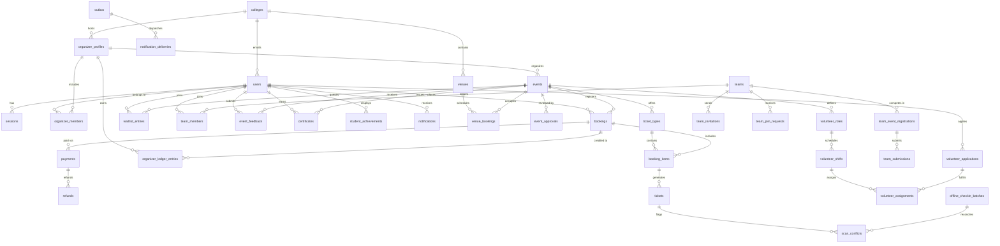

# Eventora — Entity Relationship Architecture (ERD)

**Phase:** Phase 0 Baseline  
**Specification Source:** `Eventora_20x_Master_Blueprint_Antigravity.pdf` (Pages 11–12, 23, 34)

---

## 1. Current State vs. Blueprint-Required Tables

| Table Name | Current State | Target Blueprint Role | Invariants Enforced |
| :--- | :--- | :--- | :--- |
| `users` | Planned (Phase 2) | Global user identity, Argon2id hash, status, college ID | Global role enum (`student`, `organizer`, `reviewer`, `admin`, `volunteer`, `checkin_staff`) |
| `sessions` | Planned (Phase 2) | Opaque 256-bit session token, SHA-256 hashed | Idle 30m / absolute 12h expiry, rotation on login/privilege change |
| `organizer_profiles` | Planned (Phase 2) | Club / department profile entity | Verification status, institution metadata |
| `organizer_members` | Planned (Phase 2) | Scoped organizer membership | Unique (`organizer_id`, `user_id`), scoped role |
| `colleges` | Planned (Phase 2/10) | Participating institution profile | Opt-in discovery settings, public domain |
| `events` | Planned (Phase 3) | Event proposal, lifecycle status, capacity | Status transition guards, FK to organizer & venue |
| `event_approvals` | Planned (Phase 3) | Faculty/admin review log | Decision (`APPROVED`, `CHANGES_REQUESTED`, `REJECTED`), comments |
| `venues` | Planned (Phase 3/8) | Campus physical locations & auditoriums | Building, room, accessibility metadata, capacity limit |
| `venue_bookings` | Planned (Phase 3/8) | Time-slot reservation for venues | Conflict prevention: non-overlapping confirmed slots |
| `ticket_types` | Planned (Phase 4/5) | Tiered pricing & capacity | `price_paise >= 0`, `capacity >= 0`, sales window |
| `bookings` | Planned (Phase 4/5) | Booking header, student association | `total_paise >= 0`, status, idempotency key |
| `booking_items` | Planned (Phase 4/5) | Line item snapshot | Unit price snapshot in integer paise, quantity |
| `payments` | Planned (Phase 5) | Test-mode payment record | Provider reference, amount in paise, status transitions |
| `webhook_events` | Planned (Phase 5) | Provider webhook idempotency record | Unique `provider_event_id`, processed status |
| `refunds` | Planned (Phase 5) | Simulated refund requests | Amount in paise, reason, separate status |
| `tickets` | Planned (Phase 6) | Digital ticket with QR reference | Base64url(32 random bytes) SHA-256 hash, single-use status |
| `attendance_sessions`| Planned (Phase 6) | Session attendance windows | Event session schedule, check-in policy |
| `waitlist_entries` | Planned (Phase 4) | Deterministic queue for full events | Queue position, offer expiration timestamp |
| `teams` | Planned (Phase 4) | Campus team entity | Name, leader ID, max size, visibility |
| `team_members` | Planned (Phase 4) | Team membership roster | Unique active membership, role (`LEADER`, `MEMBER`) |
| `team_invitations` | Planned (Phase 4) | Team invitation token / student invite | Expiry timestamp, status (`INVITED`, `ACCEPTED`, `DECLINED`) |
| `team_join_requests` | Planned (Phase 4) | Inbound join request from student | Status (`REQUESTED`, `APPROVED`, `REJECTED`) |
| `team_event_registrations` | Planned (Phase 4) | Team registered for competitive event | Snapshots team members at submission time |
| `team_submissions` | Planned (Phase 4) | Project title, abstract, demo URLs | Submission deadline lock |
| `volunteer_roles` | Planned (Phase 8) | Event volunteer positions | Requirements, capacity limit |
| `volunteer_shifts` | Planned (Phase 8) | Shift timing & location | Start/end timestamp, venue ID, shift capacity |
| `volunteer_applications` | Planned (Phase 8) | Student volunteer signup | Status (`APPLIED`, `APPROVED`, `REJECTED`) |
| `volunteer_assignments` | Planned (Phase 8) | Confirmed volunteer assignment | Check-in & completion timestamps |
| `event_feedback` | Planned (Phase 7) | Post-event verified ratings | Unique (`event_id`, `user_id`), rating 1-5, comment |
| `certificates` | Planned (Phase 6) | Verifiable achievement record | SHA-256 verification hash, issuance timestamp |
| `student_achievements` | Planned (Phase 10) | Student Event Passport achievements | Visibility controls (public / private sharing) |
| `notifications` | Planned (Phase 9) | In-app notification center | User ID, type, payload, read state |
| `notification_deliveries` | Planned (Phase 9) | External provider delivery log | Channel, external ID, status (`DELIVERED`, `FAILED`) |
| `outbox` | Planned (Phase 2/9) | Transactional outbox for worker dispatch | Bounded retries (8), backoff, dedupe key |
| `audit_logs` | Planned (Phase 2/8) | Security & admin activity trail | Actor ID, action, resource type/ID, safe metadata |
| `offline_checkin_batches` | Planned (Phase 9) | Batch sync for offline check-in | Device ID, session ID, sync status |
| `scan_conflicts` | Planned (Phase 9) | Discrepancy logs for multi-device scans | Conflicting scan timestamps, review status |

---

## 2. Mermaid Entity-Relationship Diagram

