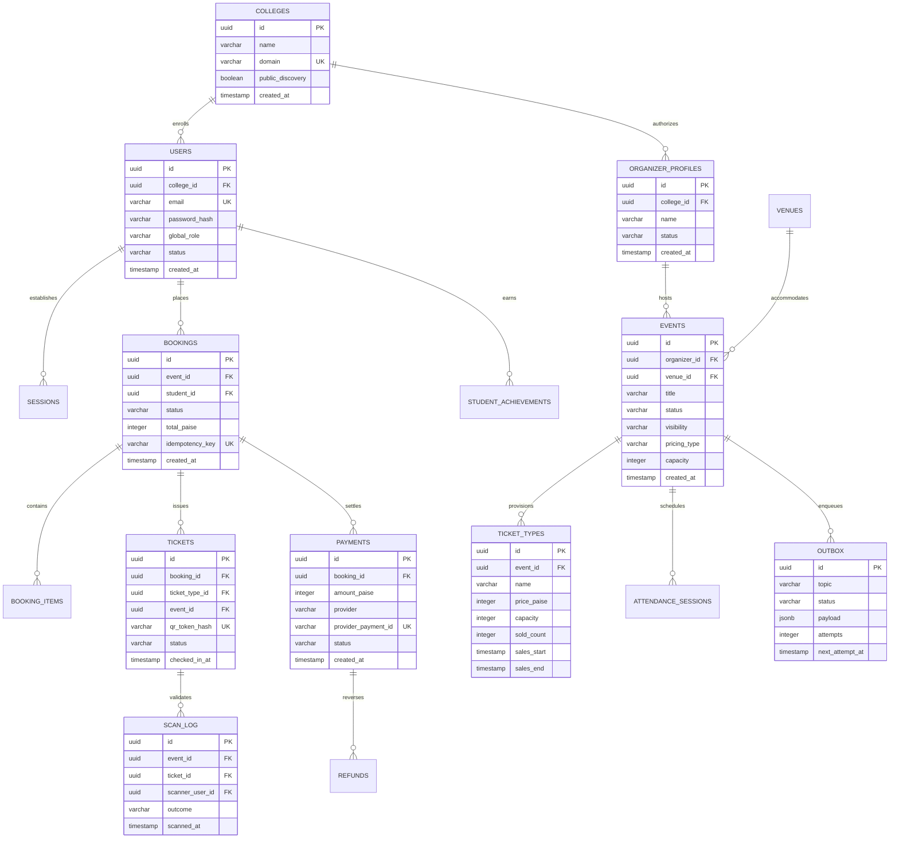

# Eventora — Entity Relationship Architecture (ERD) & Database Catalog

**Schema Revision:** Numbered Migrations 001–028 (Drizzle ORM & PostgreSQL 16)  
**System Scope:** Enterprise Campus Event Life-Cycle, Tiered Ticketing, Financial Double-Entry Accounting, Real-Time Turnstile Scanning, and Verifiable Credentials.

---

## 1. Domain Architecture & Mermaid ERD

The diagram below illustrates the core relational entity graph across Identity, Events, Bookings, Payments, Turnstile Check-ins, and Outbox dispatch.

---

## 2. Complete Database Table Catalog (60 Tables)

### Domain A: Identity, Authentication & Governance
1. `colleges`: Participating university/campus tenant record with domain whitelist and discovery flags.
2. `users`: Campus user identity; stores Argon2id password hash, canonical role (`student`, `reviewer`, `admin`), and status.
3. `sessions`: Authenticated sessions with 256-bit token SHA-256 hashes (`id_hash`), absolute 12-hour expiry, and user agents.
4. `password_resets`: Time-bounded, single-use password reset tokens with SHA-256 digests.
5. `organizer_profiles`: Student clubs, departmental associations, and festival committees.
6. `organizer_members`: Scoped membership mapping users to clubs (`owner`, `manager`, `member`).
7. `event_staff_assignments`: Event-scoped operational capabilities (`checkin`, `volunteer_lead`).
8. `user_preferences`: Notification channel toggles, marketing preferences, and accessibility overrides.
9. `audit_logs`: Immutable, append-only security log capturing actor ID, action, resource, IP address, and payload diffs.

### Domain B: Events, Venues & Approval Workflows
10. `venues`: Physical campus facilities (auditoriums, lecture halls, open grounds) with wheelchair accessibility metadata.
11. `events`: Primary event definition with lifecycle states (`draft` $\to$ `pending_approval` $\to$ `approved` $\to$ `published` $\to$ `completed`).
12. `event_status_history`: Complete audit trail of event lifecycle transitions and reviewer comments.
13. `event_approvals`: Multi-stage approval signatures from faculty mentors and campus administrative boards.
14. `venue_bookings`: Conflict-free calendar reservations holding venue slots against double-booking.
15. `event_faqs`: Frequently asked questions curated by event organizers.
16. `event_announcements`: Official broadcast alerts targeted at registered attendees.

### Domain C: Ticketing, Registrations & Waitlists
17. `ticket_types`: Tiered ticketing rules (e.g., Early Bird, General, VIP) storing `price_paise`, limits, and sales windows.
18. `bookings`: Master registration header storing total amount in integer paise, booking status, and student link.
19. `booking_items`: Granular line-item snapshot with quantity and locked unit price in integer paise.
20. `tickets`: Digital admittance token referencing opaque SHA-256 QR hash and atomic check-in state.
21. `registration_form_questions`: Custom questions created by organizers (dietary, shirt size, student ID).
22. `event_field_responses`: Attendee responses to dynamic registration questions.
23. `waitlist_entries`: Ordered queue for sold-out events with FIFO offer tokens and expiry timers.
24. `cancellations`: Cancellation log releasing seat capacities and triggering automatic waitlist sweeps.

### Domain D: Payments, Refunds & Financial Double-Entry Ledger
25. `payments`: Payment attempts and confirmations storing amount in integer paise, provider ref, and state.
26. `payment_attempts`: Telemetry log capturing gateway attempts, latencies, and gateway error codes.
27. `webhook_events`: Idempotent log of raw incoming gateway webhooks with unique provider event IDs.
28. `payment_events`: Internal payment state change event log for financial audits.
29. `webhook_deliveries`: Outbound webhook dispatch logs for external campus system integrations.
30. `refunds`: Refund requests and reversals in integer paise with approval status.
31. `organizer_ledger_entries`: Double-entry accounting journal (`SALE` credits and `REFUND` debits).
32. `reconciliation_records`: Periodic settlement runs comparing bank statements against internal orders.
33. `reconciliation_items`: Discrepancy flags and resolution notes for manual finance review.
34. `receipts`: Tax-compliant invoices and receipts generated for verified student transactions.

### Domain E: Attendance, Turnstile Scanning & Offline Sync
35. `attendance_sessions`: Designated time windows for event check-in gates.
36. `scan_log`: High-throughput scanner telemetry capturing scan outcomes (`ACCEPTED`, `DUPLICATE`, etc.).
37. `offline_manifests`: Cryptographically signed JSON manifests cached on staff mobile scanners.
38. `offline_checkin_batches`: Batched check-in submissions uploaded when scanners regain network connectivity.
39. `offline_ops`: Individual check-in operations executed client-side with device-generated nonces.
40. `scan_conflicts`: Detected multi-device conflicts queued for supervisor manual review.

### Domain F: Teams, Hackathons & Competitions
41. `teams`: Competitive team entities with student captain, member bounds, and join codes.
42. `team_members`: Roster linking students to teams with membership status (`ACTIVE`, `REQUESTED`).
43. `team_invitations`: Time-limited join invitations issued by team leaders.
44. `team_join_requests`: Inbound student requests to join existing public teams.
45. `team_event_registrations`: Snapshot linking a verified team roster to a competitive event.
46. `team_submissions`: Project abstracts, GitHub repositories, and presentation slide URLs.

### Domain G: Volunteers & Campus Resources
47. `volunteer_roles`: Volunteer staffing positions with skill prerequisites and quotas.
48. `volunteer_shifts`: Specific shift time windows and assigned campus zones.
49. `volunteer_records`: Verified hours served, shift check-in timestamps, and supervisor ratings.
50. `equipment_items`: Inventory of campus AV gear, microphones, podiums, and turnstiles.
51. `equipment_requests`: Club reservation requests for campus logistics equipment.
52. `support_issues`: Attendee helpdesk tickets regarding lost tickets, access issues, or schedule questions.
53. `support_issue_events`: Communication history between attendees and student support agents.
54. `guest_registrations`: Special registration records for external VIPs, speakers, and faculty guests.

### Domain H: Passports, Badges & Feedback
55. `passport_settings`: Student privacy preferences governing public achievement sharing.
56. `student_achievements`: Tamper-proof achievement records (attendance, winning hackathons, volunteering).
57. `certificates`: PDF certificate metadata and SHA-256 verification hashes.
58. `certificate_policies`: Automated issuance criteria (e.g., minimum 80% session attendance required).
59. `event_feedback`: Verified attendee ratings (1–5 stars) and moderated feedback text.
60. `feedback_reports`: Attendee flags on inappropriate or abusive feedback entries.
61. `feedback_questions`: Dynamic survey questions presented to attendees post-event.
62. `export_jobs`: Asynchronous CSV report generation tasks with signed download URLs.
63. `event_metrics`: Aggregated statistical metrics (conversion rates, revenue in paise, attendance %).

### Domain I: System, Notifications & Outbox
64. `notifications`: In-app notification center inbox items with read states.
65. `event_alerts`: High-priority broadcast notifications (e.g. venue changes, rain delays).
66. `notification_metrics`: Delivery latency, open rates, and push failure statistics.
67. `outbox`: Transactional outbox table for reliable at-least-once message delivery.
68. `organizer_verifications`: Institutional verification workflow for new student organizations.
69. `ops_runs`: Operational audit records capturing disaster recovery rehearsals, migrations, and health runs.
70. `schema_migrations`: PostgreSQL version migration ledger tracking applied migration scripts.

---

## 3. Core Structural Invariants Enforced by Schema

1. **Monetary Integer Representation:** All money amounts (`price_paise`, `total_paise`, `amount_paise`) are strictly non-negative integers representing paise ($100\text{ paise} = ₹1.00$). Floating-point monetary fields are forbidden.
2. **Deterministic Locking:** Seat allocations enforce `SELECT ... FOR UPDATE` row locks inside PostgreSQL transactions; overselling is mathematically impossible.
3. **Zero PII Exposure in QR Codes:** Tickets reference 43-character opaque cryptographic tokens (`crypto.randomBytes(32)`). No student names, emails, or phone numbers are encoded in QR payloads.
4. **Referential Integrity & Cascading Policies:** Critical operational entities (`tickets`, `payments`, `audit_logs`) use `ON DELETE RESTRICT` to ensure zero accidental loss of financial or compliance records.
